 

 

---

### 👋 About Me

Robotics & Artificial Intelligence Engineering student at **Universitas Airlangga**, based in Surabaya. My focus is on giving machines a sense of "thinking" — pairing solid programming fundamentals with a design-conscious eye to build tech that's as functional as it is well-crafted. I don't just follow trends in the field, I dig into them, staying curious and comfortable trying things I haven't done before.

 

---

**⚡ Quick facts**

- 🎓 Robotics Engineering & AI, Universitas Airlangga (Surabaya)
- 🥇 Graduated top of the MIPA program at MAN 1 Kudus 
- 🔭 Currently building my personal portfolio site 
- 🎯 Aiming for a Master's abroad, with a robotics/AI industry role as the backup path
- 💬 Happy to talk robotics, embedded systems, or product design
- 📫 rafaalbanin19207@gmail.com

 

<b>🏆 Achievements & Experience</b> — click to expand

 

**Competitions & certifications**
- 🥉 3rd Place — KRENOVA Competition, Kabupaten Kudus (2024)
- 🎖️ Finalist — LKTI Diponegoro Chemistry Fair (DCF), Universitas Diponegoro (2024)
- 📐 Participant — Olimpiade Polymer, Universitas Jember (2024)
- 🥈 Bronze Medal — Olimpiade Sains Airlangga (OSA), Mathematics (2023)
- 📜 Data Analytics & Design Bootcamp — President University (Mechanical Engineering track)

**Organizational experience**
- HIMATERA (Himpunan Mahasiswa Teknik Robotika) — Staff, PSDM Division
- PKKMB Program Studi 2026 — Perkap (Equipment & Logistics) Coordinator
- Robo Impact — taught basic Arduino & programming to schools around Surabaya

 

---

### 🛠️ Tech Stack

  
                      

 

---

  
### Activity🎶

